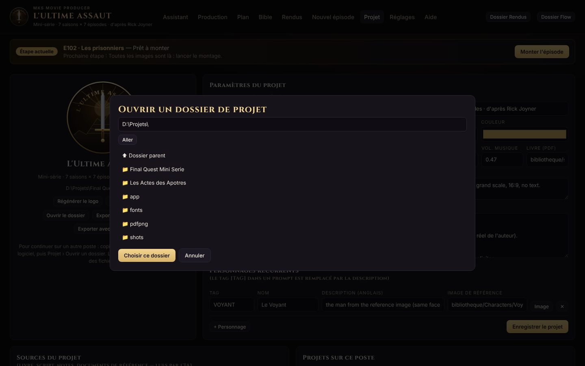

# MKS Movie Producer — Manuel d'installation

Version 1.2 · octobre 2026

Ce manuel explique comment installer MKS Movie Producer sur un poste, vérifier que tout fonctionne, brancher les modèles d'IA et transférer un projet d'un ordinateur à un autre. L'utilisation au quotidien est décrite dans le **Manuel d'utilisation**.

## 1. Ce que contient le livrable

MKS Movie Producer est une application locale : elle tourne sur votre ordinateur et s'utilise dans le navigateur, à l'adresse `http://localhost:8765`. Rien n'est hébergé sur Internet ; seules la voix off (Microsoft Edge TTS) et les étapes d'IA, si vous les utilisez, passent par le réseau.

| Fichier ou dossier | Rôle |
|---|---|
| `INSTALLER.bat` | Installation complète sous Windows (à lancer une fois par poste) |
| `PILOTAGE.bat` | Lance l'application et ouvre l'interface dans le navigateur |
| `ATELIER.bat` | Menu en mode texte (sans navigateur), pour dépanner |
| `install.ps1` | Script appelé par `INSTALLER.bat` |
| `install.sh` | Installation sous macOS ou Linux |
| `pilotage.py` | Serveur local et interface web |
| `atelier.py` | Ligne de commande : monter, fiche, écrire, exporter… |
| `moteur.py` | Montage vidéo (ffmpeg), voix off, musique |
| `ia.py`, `cles.py` | Appels aux modèles d'IA, gestion des clés |
| `contexte.py` | Projet actif, réglages, migration |
| `fiche.py`, `logo.py` | Fiches de prompts, logos générés |
| `mcp_server.py` | Serveur MCP pour piloter le projet depuis Claude |
| `web/index.html` | L'interface |
| `docs/` | Ce manuel, le manuel d'utilisation et leurs captures |
| `METTRE_A_JOUR.bat` | Récupère la dernière version depuis GitHub (section 5) |
| `modele-projet/` | Projet vide déjà organisé, à copier pour démarrer un projet (section 9) |
| `README.md`, `CLAUDE.md` | Présentation du dépôt ; notes pour Claude Code |
| `LISEZ-MOI.txt` | Aide-mémoire d'une page |

Les dossiers `musique/`, `polices/`, `travail/` et `cache/` sont créés par l'installation et le montage. Ils ne sont pas dans le paquet.

> **Logiciel et projets sont séparés.** Le dossier du logiciel contient le code et les réglages de *ce poste*. Chaque œuvre (série, film) vit dans son propre **dossier de projet**, qui voyage d'un poste à l'autre. Voir la section 9.

## 2. Configuration requise

| Élément | Minimum conseillé |
|---|---|
| Système | Windows 10 ou 11 (64 bits) ; macOS 12+ ou Linux récent |
| Processeur et mémoire | 4 cœurs, 8 Go de RAM (16 Go confortable pour les montages) |
| Espace disque | 1 Go pour le logiciel ; compter 2 à 4 Go par saison de 7 épisodes (images, vidéos, rendus) |
| Navigateur | Chrome, Edge ou Firefox récent |
| Internet | Pendant l'installation ; pendant le montage (voix Edge) ; pour les étapes d'IA |
| Droits | Compte Windows pouvant installer des logiciels (winget) |

L'installation ajoute automatiquement, si besoin : **Python 3.12**, **ffmpeg**, les modules Python `edge-tts`, `pypdf`, `anthropic`, `openai`, `mcp` et `keyring`, la police **Cinzel** et les **14 musiques** de la bibliothèque.

## 3. Installation sous Windows

### 3.1 Décompresser

1. Copiez `MKS-Movie-Producer_v1.0.zip` sur le poste.
2. Clic droit › **Extraire tout…** vers un dossier de votre choix, par exemple `D:\Logiciels\`. Vous obtenez `D:\Logiciels\MKS-Movie-Producer\`.

Deux dispositions sont possibles :

| Disposition | Exemple | Quand la choisir |
|---|---|---|
| **Logiciel à part** (recommandé) | `D:\Logiciels\MKS-Movie-Producer\` et `D:\Projets\L'Ultime Assaut\` | Plusieurs projets sur le même poste |
| **Logiciel dans le projet** | `D:\Projets\L'Ultime Assaut\atelier\` | Un seul projet ; tout est dans un seul dossier à copier |

Dans la seconde disposition, au premier lancement, l'application prend automatiquement le dossier parent comme projet.

### 3.2 Lancer l'installation

1. Double-cliquez sur **`INSTALLER.bat`**. Une fenêtre bleue PowerShell s'ouvre.
2. Si Python n'est pas installé, il est installé puis la fenêtre demande de **la fermer et de relancer `INSTALLER.bat`**. Faites-le : Windows ne voit Python qu'après réouverture.
3. L'installation se poursuit : ffmpeg, modules Python, police, musiques. Comptez 2 à 5 minutes.
4. Le message **« Installation terminée. Lance PILOTAGE.bat »** s'affiche. Appuyez sur Entrée.

> Si Windows affiche « Windows a protégé votre ordinateur », cliquez sur **Informations complémentaires › Exécuter quand même**. Les scripts sont lisibles en clair dans le dossier.

### 3.3 Premier lancement

1. Double-cliquez sur **`PILOTAGE.bat`**. Une fenêtre noire s'ouvre et affiche :
   `Interface : http://localhost:8765 (laisser cette fenêtre ouverte, Ctrl+C pour arrêter)`
2. Le navigateur s'ouvre sur l'interface. S'il ne s'ouvre pas, tapez `http://localhost:8765` dans la barre d'adresse.
3. **Laissez la fenêtre noire ouverte** tant que vous travaillez : c'est le moteur de l'application. La fermer arrête l'interface.

Pour quitter : fermez l'onglet, puis la fenêtre noire (ou Ctrl+C dans celle-ci).

> Après une mise à jour du logiciel, appuyez sur **Ctrl+F5** dans le navigateur pour recharger l'interface sans cache.

## 4. Installation sous macOS ou Linux

1. Installez ffmpeg : `brew install ffmpeg` (macOS, avec Homebrew) ou `sudo apt install ffmpeg` (Debian, Ubuntu).
2. Vérifiez que Python 3.10 ou plus récent est présent : `python3 --version`.
3. Dans un terminal, placez-vous dans le dossier du logiciel puis lancez :

```bash
chmod +x install.sh
./install.sh
python3 pilotage.py
```

L'interface s'ouvre sur `http://localhost:8765`. Sur ces systèmes, les clés d'IA sont rangées dans le Trousseau (macOS) ou le Secret Service (Linux).

## 5. Versionner sur GitHub et développer avec Claude Code

Le paquet contient l'historique git du logiciel et un fichier `CLAUDE.md` qui décrit son architecture à Claude Code. Cette procédure, à faire une fois, publie le code sur un dépôt GitHub **privé**, transforme le dossier du logiciel installé en copie versionnée, puis permet de faire évoluer l'application avec Claude Code.

Dans les commandes ci-dessous, remplacez `<compte>` par votre identifiant GitHub et adaptez les chemins. Les commandes se tapent dans **PowerShell** (menu Démarrer › « PowerShell »).

### 5.1 Prérequis (une fois par poste)

**Étape 1 — Compte GitHub.** Créez-le sur github.com (Sign up) si nécessaire.

**Étape 2 — Git pour Windows.**

```powershell
winget install --id Git.Git -e
```

**Étape 3 — Votre identité.** Fermez et rouvrez PowerShell, puis indiquez votre nom et l'adresse de votre compte GitHub (ils signent chaque version) :

```powershell
git config --global user.name "Votre Nom"
git config --global user.email "adresse-de-votre-compte-github@exemple.com"
```

**Étape 4 — Claude Code** (abonnement Claude Pro, Max, Team ou Enterprise) :

```powershell
irm https://claude.ai/install.ps1 | iex
```

Rouvrez PowerShell et vérifiez avec `claude --version`. Au premier lancement de `claude`, une page de connexion s'ouvre dans le navigateur.

### 5.2 Créer le dépôt sur GitHub

1. Ouvrez github.com/new.
2. **Repository name** : `mks-movie-producer`. Cochez **Private**.
3. **Ne cochez rien d'autre** : pas de README, pas de .gitignore, pas de licence. Le dépôt doit être vide.
4. **Create repository**. Gardez l'adresse affichée : `https://github.com/<compte>/mks-movie-producer.git`.

### 5.3 Envoyer le code (premier push)

Clic droit sur `_exports\MKS-Movie-Producer_v1.0.zip` › **Extraire tout…** vers un dossier temporaire, par exemple `D:\Temp`. Vous obtenez `D:\Temp\MKS-Movie-Producer`, qui contient l'historique (dossier caché `.git`). Puis, dans PowerShell :

```powershell
cd D:\Temp\MKS-Movie-Producer
git log --oneline
git remote add origin https://github.com/<compte>/mks-movie-producer.git
git push -u origin main
```

`git log` doit afficher la liste des versions. Au premier `git push`, une fenêtre **Git Credential Manager** s'ouvre : choisissez **Sign in with your browser** et autorisez l'accès. Rechargez la page du dépôt sur GitHub : le code et son historique y sont.

### 5.4 Relier le logiciel installé au dépôt

Le dossier du logiciel que vous utilisez (par exemple `atelier\` dans le projet) devient une copie du dépôt : les mises à jour arriveront par `git pull`, et Claude Code pourra y travailler directement.

```powershell
cd "D:\Chemin\du\projet\atelier"
git init -b main
git remote add origin https://github.com/<compte>/mks-movie-producer.git
git fetch origin
git reset --hard origin/main
git branch --set-upstream-to=origin/main main
git status
```

`git reset --hard` remplace uniquement les fichiers **du logiciel** par la version GitHub (identique à celle installée). Les réglages du poste, les clés, les musiques, la police et les fichiers de travail ne sont pas suivis par git (fichier `.gitignore`) et restent en place ; les données du projet, dans le dossier parent, ne sont jamais concernées. `git status` doit répondre *« nothing to commit, working tree clean »* (ou ne lister que des fichiers à vous, comme `MONTER_E104.bat`, que git ignore). Le dossier temporaire `D:\Temp\MKS-Movie-Producer` peut ensuite être supprimé.

### 5.5 Faire évoluer l'application avec Claude Code

**En local (recommandé pour cette application)** : Claude Code travaille dans le dossier du logiciel, sur votre poste, avec ffmpeg, vos musiques et vos projets réels pour tester.

1. PowerShell dans le dossier du logiciel, puis `claude`. Claude lit `CLAUDE.md` automatiquement.
2. Décrivez l'évolution voulue. Pour un changement important, demandez une branche : *« crée une branche pour cette évolution »*.
3. Testez : relancez `PILOTAGE.bat`, Ctrl+F5.
4. Validez : *« commit et push »*. Pour une branche, ouvrez ensuite la **pull request** proposée par GitHub et cliquez sur **Merge**.

**Dans le cloud (claude.ai/code)** : utile depuis un autre ordinateur ou le téléphone, sans rien installer.

1. Ouvrez claude.ai/code, connectez votre compte GitHub, puis installez l'application GitHub **Claude** sur le dépôt `mks-movie-producer` (nécessaire pour un dépôt privé).
2. Choisissez le dépôt, décrivez la tâche. Claude travaille sur une copie dans le cloud et pousse une branche ; **Create PR**, puis **Merge** sur GitHub.
3. Sur le poste : double-clic sur `METTRE_A_JOUR.bat` dans le dossier du logiciel (ou `git pull`), puis relancez `PILOTAGE.bat` et Ctrl+F5.

> Les clés d'API, les réglages du poste et les données des projets ne vont jamais sur GitHub. Le dépôt ne contient que le code, l'interface, les manuels et le modèle de projet.

### 5.6 Installer depuis GitHub sur un autre poste

```powershell
git clone https://github.com/<compte>/mks-movie-producer.git
cd mks-movie-producer
```

Puis `INSTALLER.bat` (Windows) ou `./install.sh` (macOS, Linux), ou demandez à Claude Code : *« Installe MKS Movie Producer depuis ce dossier (lis CLAUDE.md) puis ouvre le projet D:\Projets\L'Ultime Assaut. »*

## 6. Vérifier l'installation

Ouvrez l'onglet **Assistant**. Le cadre **Installation et outils** contrôle chaque élément :


| Ligne | Si elle est orange (●) |
|---|---|
| ffmpeg installé | Relancer `INSTALLER.bat`, puis fermer et rouvrir `PILOTAGE.bat` |
| Voix Edge (module edge-tts) | Relancer `INSTALLER.bat` |
| Musiques (14/14) | Relancer `INSTALLER.bat` (téléchargement interrompu) |
| Police des titres | Relancer `INSTALLER.bat` |
| Sources du projet | Ajouter le livre ou le script : Projet › Sources |
| Référence : (personnage) | Déposer l'image du personnage : Projet › Personnages › Image |
| Clés IA (facultatif) | Réglages › Modèles IA (section 7) |

Quand toutes les lignes sont vertes (✔), le poste est prêt. Les clés d'IA restent facultatives : sans elles, tout fonctionne sauf les boutons marqués **IA**.

## 7. Configurer les modèles d'IA et les clés

Les étapes d'IA (écrire un épisode, réécrire les prompts, relire les images, générer la bible) passent par un modèle de votre choix.


1. Ouvrez **Réglages**.
2. Sur la ligne du modèle voulu (par exemple *Claude Sonnet*), collez la clé API dans **Clé API**, puis cliquez sur **OK**. L'état passe à « enregistrée ».
3. Cliquez sur **Tester** : une fenêtre affiche la réponse du modèle et le temps de réponse.
4. Dans **Quel modèle pour quelle étape**, choisissez le modèle de chaque tâche, puis **Enregistrer les réglages**.

| Fournisseur | Où obtenir une clé | Remarque |
|---|---|---|
| Anthropic (Claude) | console.anthropic.com › API Keys | Profils Sonnet, Opus, Haiku fournis |
| OpenRouter | openrouter.ai/keys | Accès à de nombreux modèles avec une seule clé |
| OpenAI ou compatible | platform.openai.com | Choisir « Compatible OpenAI » et l'URL du service |
| Ollama (local) | Aucune clé | Modèle installé sur le poste, URL `http://localhost:11434/v1` |

- **+ Ajouter un modèle** crée un profil libre (Mistral, Gemini, etc.) : renseignez le fournisseur « Compatible OpenAI », l'URL et le nom exact du modèle.
- La case **« une clé saisie vaut pour tous les modèles du même fournisseur »** évite de recoller la même clé Anthropic sur Sonnet, Opus et Haiku.

> **Sécurité des clés.** Les clés sont rangées dans le **Gestionnaire d'identification Windows** (ou le trousseau du système), sous le nom de service `ultime-assaut-atelier`. Elles ne sont jamais écrites dans le projet, dans `reglages.json` ni dans un export zip. Si le trousseau est indisponible, un fichier `.cles.json` local au logiciel sert de repli ; il est exclu de git.

## 8. Connecter Claude (MCP)

Le serveur MCP permet à Claude (Desktop ou Code) de lire et piloter le projet actif : lister et écrire les épisodes, lire le livre et les sources, générer une fiche, lancer un montage, consulter l'état de la production et la bible.

### Claude Desktop

Paramètres › Développeur › **Modifier la configuration**, puis ajoutez (en adaptant le chemin) :

```json
{
  "mcpServers": {
    "mks-movie-producer": {
      "command": "py",
      "args": ["-3", "D:\\Logiciels\\MKS-Movie-Producer\\mcp_server.py"]
    }
  }
}
```

Redémarrez Claude Desktop. Les outils apparaissent sous le nom `mks-movie-producer`.

### Claude Code

```bash
claude mcp add mks-movie-producer -- py -3 "D:\Logiciels\MKS-Movie-Producer\mcp_server.py"
```

Sous macOS ou Linux, remplacez `py -3` par `python3`.

| Outil MCP | Effet |
|---|---|
| `projet_actif`, `etat_production` | Projet ouvert, étape de chaque épisode |
| `lire_bible`, `lire_sources`, `lire_livre` | Contexte de l'œuvre |
| `lister_episodes`, `lire_episode`, `ecrire_episode` | Scripts des épisodes |
| `etat_images`, `generer_fiche_flow` | Images manquantes, fiche de prompts |
| `monter_episode` | Montage d'un épisode, dans la langue d'origine ou une version (`langue`) |
| `etat_traductions`, `enregistrer_traductions`, `traduire_episode` | Versions linguistiques : état, traductions écrites par Claude, traduction par l'IA de l'application |

## 9. Organisation des dossiers

### Le dossier du logiciel (propre au poste)

```
MKS-Movie-Producer/
  pilotage.py, atelier.py, moteur.py…   le code
  web/index.html                         l'interface
  docs/                                  les manuels
  reglages.json      modèles IA choisis sur ce poste
  poste.json         projets connus et projet actif
  musique/           14 pistes (installées)
  polices/           Cinzel.ttf (installée)
  travail/, cache/   fichiers temporaires de montage
```

### Le dossier d'un projet (voyage d'un poste à l'autre)

Un nouveau projet est créé avec cette organisation : ce qui se **prépare** dans `bibliotheque`, ce qui se **fabrique** dans `production`.

```
L'Ultime Assaut/
  projet.json          paramètres du projet et carte des dossiers
  suivi.json           épisodes validés
  bibliotheque/
    sources/           livre (PDF), scripts, notes, documents de référence
    personnages/       images de référence des personnages
    bible/             bible.md et plan.json (le plan des épisodes)
    episodes/          scripts des épisodes : E101.json, E102.json…
    logo.svg           logo affiché dans la bannière
  production/
    fiches/            fiches de prompts : E104_fiche_Flow.txt…
    images/E104/       images et vidéos générées : E104-01.png, E104-07.mp4…
    rendus/            épisodes montés (.mp4) et leurs sous-titres (.srt)
      en/              versions traduites (un sous-dossier par langue)
  _exports/            zips d'export
```

Le dossier **`modele-projet`** du logiciel contient exactement cette organisation, vide, avec un plan de 7 épisodes et une bible à compléter. Pour démarrer sans passer par l'application, copiez-le, renommez-le, puis **Projet › Ouvrir un dossier existant…**

### Ranger le projet librement

Cette organisation n'est pas imposée. Vous pouvez renommer, regrouper ou déplacer les dossiers dans l'Explorateur : **seuls `projet.json` et `suivi.json` doivent rester à la racine**.

- Chaque dossier a un **rôle** (sources, personnages, bible, épisodes, fiches, images, rendus, exports, musique). Le dossier de chaque rôle est noté dans `projet.json`.
- Si un dossier a été déplacé, l'application le **retrouve d'après son contenu** : des scripts `.json` d'épisodes, un `plan.json`, des fiches `_fiche_Flow.txt`, des sous-dossiers d'images nommés comme les épisodes, etc. Elle met alors `projet.json` à jour.
- Le livre, le logo et les images de référence déplacés sont retrouvés **par leur nom de fichier**, n'importe où dans le projet.
- Une image de plan rangée hors du dossier des images (par exemple dans un ancien dossier `Flow`) est elle aussi retrouvée par son nom.

La recherche a lieu au lancement de `PILOTAGE.bat` et dès qu'un dossier manque. Le panneau **Projet › Organisation du projet** affiche la carte des dossiers et permet de la corriger (manuel d'utilisation, section 13.5).

**L'avancement est entièrement recalculé à partir des fichiers** : script présent, fiche présente, nombre d'images rangées, rendu présent, validation. Il n'y a pas de base de données à transférer.

## 10. Transférer un projet sur un autre poste

1. Sur le poste d'origine : **Projet › Exporter (zip, sans rendus)**. Le zip arrive dans `_exports\` du projet. Choisissez **Exporter avec rendus** pour emporter aussi les vidéos montées (fichier beaucoup plus gros). Vous pouvez aussi copier simplement le dossier du projet.
2. Sur le nouveau poste : installez le logiciel (section 3), puis décompressez ou copiez le projet où vous voulez.
3. Lancez `PILOTAGE.bat`, ouvrez **Projet › Ouvrir un dossier existant…**, naviguez jusqu'au dossier du projet (ou collez son chemin), puis **Choisir ce dossier**.
4. L'Assistant se positionne aussitôt sur l'étape où vous en étiez.



Ce qui **ne voyage pas** avec le projet, et qu'il faut refaire sur chaque poste : les clés d'IA et le choix des modèles (Réglages), les musiques et la police (installées par `INSTALLER.bat`).

## 11. Mettre à jour le logiciel

- **Avec git** (logiciel relié à GitHub, section 5.4) : double-clic sur `METTRE_A_JOUR.bat`, ou `git pull` dans le dossier du logiciel, puis relancez `PILOTAGE.bat` et faites Ctrl+F5 dans le navigateur.
- **Avec un zip** : fermez la fenêtre `PILOTAGE`, remplacez les fichiers du logiciel par ceux du nouveau zip **sans supprimer** `reglages.json`, `poste.json`, `musique\`, `polices\` et `.cles.json` s'il existe. Relancez `PILOTAGE.bat`, puis Ctrl+F5.

Les projets ne sont jamais modifiés par une mise à jour du logiciel.

## 12. Migration depuis l'ancien atelier

Les versions précédentes rangeaient les épisodes, la bible, le suivi et `config.json` *dans* le dossier `atelier`. Au premier lancement de MKS Movie Producer, la migration est automatique :

- `episodes\`, `bible\` et `suivi.json` sont déplacés dans le dossier du projet (le parent de `atelier`), que vous pouvez ensuite ranger à votre guise (section 9) ;
- `projet.json` est créé avec les réglages de la série (voix, style, personnage du Voyant, règles) ;
- `reglages.json` reprend les profils d'IA ; `config.json` est renommé `config.ancien.json` ;
- la fenêtre noire affiche « Migration vers le format projet : … ».

Aucun fichier n'est perdu : en cas de doublon, la version déjà présente dans le projet est conservée.

## 13. Désinstaller

1. Fermez la fenêtre `PILOTAGE`.
2. Supprimez le dossier du logiciel. Vos projets ne sont pas touchés.
3. Facultatif : supprimez les clés dans **Panneau de configuration › Gestionnaire d'identification › Informations d'identification Windows**, entrées `ultime-assaut-atelier`.
4. Facultatif : Python et ffmpeg se désinstallent depuis **Paramètres › Applications**.

## 14. Dépannage

| Symptôme | Cause probable | Solution |
|---|---|---|
| `INSTALLER.bat` s'arrête après Python | Python vient d'être installé | Fermer la fenêtre et relancer `INSTALLER.bat` |
| « winget n'est pas reconnu » | App Installer absent (Windows ancien) | Installer « App Installer » depuis le Microsoft Store, ou Python et ffmpeg à la main |
| La page ne s'ouvre pas | Fenêtre `PILOTAGE` fermée | Relancer `PILOTAGE.bat` |
| `git push` refusé (« rejected », « fetch first ») | Le dépôt GitHub n'était pas vide (README créé à la création) | Recréer le dépôt vide, ou `git pull --rebase origin main` puis `git push` |
| Git : « detected dubious ownership » | Dossier créé par un autre compte Windows | Lancer la commande `git config --global --add safe.directory` indiquée dans le message |
| « Address already in use » | Une autre fenêtre `PILOTAGE` tourne déjà | Fermer l'ancienne fenêtre ; ou changer de port : `set ATELIER_PORT=8766` avant `py -3 pilotage.py` |
| Interface ancienne ou incomplète | Cache du navigateur | Ctrl+F5 |
| ffmpeg reste orange après installation | La fenêtre a été ouverte avant l'installation | Fermer et rouvrir `PILOTAGE.bat` |
| Montage : erreur de voix | Pas d'Internet (Edge TTS est en ligne) | Vérifier la connexion, relancer le montage (il reprend où il s'était arrêté) |
| « Échec du test » dans Réglages | Clé, nom de modèle ou URL incorrects | Recoller la clé ; vérifier le nom exact du modèle |
| Projet « introuvable » dans la liste | Dossier déplacé ou disque débranché | Projet › Ouvrir un dossier existant, puis retirer l'ancienne entrée (✕) |
| Titres sans la police Cinzel | Police non téléchargée | Relancer `INSTALLER.bat` |
| Après un rangement du projet, des épisodes, le livre ou une référence n'apparaissent plus | Dossier déplacé sans contenu reconnaissable, ou fichier renommé | Projet › Organisation du projet › **Rechercher les dossiers déplacés** ; sinon **Choisir…** le bon dossier pour ce rôle |
| Les nouvelles images n'apparaissent pas | Images enregistrées dans un dossier qui n'est pas celui du projet | Vérifier le dossier indiqué en tête de la fiche de prompts |

En dernier recours, `ATELIER.bat` ouvre un menu texte qui permet de monter un épisode, de vérifier les images ou de générer une fiche sans passer par le navigateur.

## 15. Licences et crédits

- **Musiques** : Kevin MacLeod (incompetech.com), licence Creative Commons Attribution 4.0. Le crédit est obligatoire dans la description de chaque vidéo publiée : *Musique : Kevin MacLeod (incompetech.com), licence CC BY 4.0*.
- **Voix** : Microsoft Edge TTS (service en ligne).
- **Police** : Cinzel, SIL Open Font License.
- **Outils** : Python, ffmpeg, pypdf, SDK Anthropic et OpenAI, MCP.
