# MKS Movie Producer — Manuel d'utilisation

Version 1.3 · octobre 2026

MKS Movie Producer transforme un livre, un script ou un ensemble de documents en série vidéo narrée. Les épisodes sont écrits plan par plan, les images sont générées dans l'outil de votre choix (Google Flow, Higgsfield…), puis le montage est automatique : voix off et voix des personnages, musique adaptée à chaque scène, ambiances et bruitages, titres, mouvements de caméra. Les exemples de ce manuel viennent du premier projet réalisé avec l'outil, **L'Ultime Assaut** (7 saisons × 7 épisodes × 7 minutes).

L'installation est décrite dans le **Manuel d'installation**. Ce manuel-ci est aussi consultable dans l'application, menu **Aide**.

## 1. Le principe en une page

Chaque épisode suit la même chaîne de production. L'application calcule à tout moment où en est chaque épisode, uniquement à partir des fichiers présents dans le dossier du projet.

| Étape | Ce que vous faites | Ce qui la valide |
|---|---|---|
| 0. Préparer le projet | Ajouter les sources ; écrire ou générer la bible et le plan | Le plan (`plan.json`) est rempli |
| 1. À écrire | Écrire le script de l'épisode (vous, l'IA ou Claude) | Le script `E104.json` existe |
| 2. Script écrit | Relire le script, générer la fiche de prompts | La fiche `E104_fiche_Flow.txt` existe |
| 3. Fiche prête / Images en cours | Générer les images avec la fiche, les ranger sous leur nom | Images `E104-01.png`… présentes |
| 4. Prêt à monter | Lancer le montage | Toutes les images sont là |
| 5. Monté | Regarder le rendu, corriger si besoin, remonter | Un rendu `.mp4` existe |
| 6. Validé | Valider l'épisode | Validation enregistrée dans `suivi.json` |

Les dossiers où l'application cherche ces fichiers sont décrits dans l'onglet **Projet › Organisation du projet** (section 13.5). Vous pouvez les ranger comme vous le souhaitez.

L'**Assistant** suit cette chaîne épisode par épisode, dans l'ordre du plan, et vous indique toujours l'action suivante.

## 2. Lancer et quitter

1. Double-cliquez sur **`PILOTAGE.bat`** (dans le dossier du logiciel).
2. L'interface s'ouvre dans le navigateur sur `http://localhost:8765`. Elle n'est accessible que depuis ce PC.
3. Laissez la fenêtre noire ouverte pendant le travail.

Pour quitter : fermez l'onglet puis la fenêtre noire. Rien n'est perdu : tout est enregistré dans les fichiers du projet au fur et à mesure.

## 3. L'écran principal

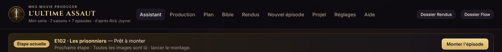

- **La bannière** (en haut à gauche) affiche le logo et le nom du projet ouvert, son sous-titre et le nom du logiciel. Cliquer dessus ouvre l'onglet **Projet**.
- **Le menu** donne accès aux neuf vues : Assistant, Production, Plan, Bible, Rendus, Nouvel épisode, Projet, Réglages, Aide.
- **Dossier Rendus** et **Dossier Flow** ouvrent dans l'Explorateur Windows le dossier des rendus et celui des images.
- **Le bandeau « Étape actuelle »**, sous le menu, rappelle sur chaque page l'épisode en cours, son étape, la prochaine action, et propose le bouton qui la lance.

### Les tâches en cours

Les opérations longues (montage, écriture par l'IA, export…) tournent en arrière-plan. Un panneau apparaît en bas à droite avec leur journal en direct. Cliquez sur son titre pour le replier. Vous pouvez continuer à travailler pendant ce temps, et lancer plusieurs tâches à la suite.

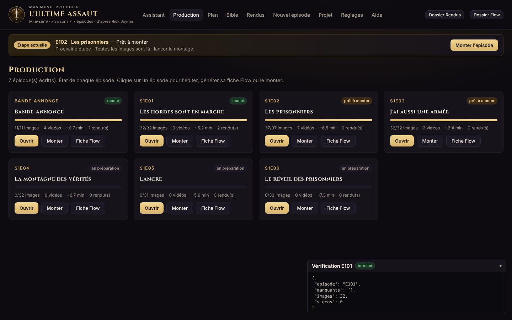

## 4. Assistant

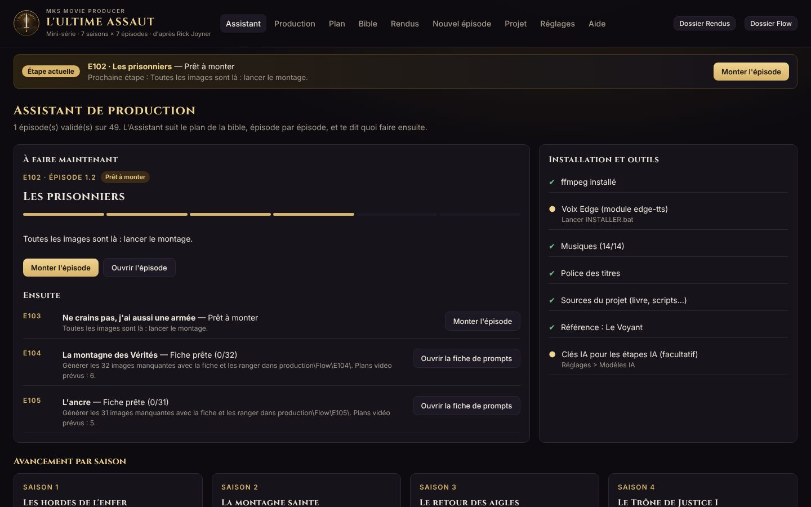

L'Assistant est la page d'accueil. Il présente :

- **À faire maintenant** : l'épisode en cours, sa barre d'avancement en six segments, la prochaine étape et le bouton d'action (*Écrire le script*, *Ouvrir la fiche de prompts*, *Monter l'épisode*, *Regarder et valider*…).
- **Ensuite** : les trois épisodes suivants et leur action.
- **Installation et outils** : l'état du poste (ffmpeg, voix, musiques, police, sources, images de référence, clés d'IA). Une pastille orange indique ce qu'il reste à faire.
- **Avancement par saison** : le nombre d'épisodes validés par saison ; **Voir les épisodes** ouvre le Plan sur cette saison.

Sur un projet neuf, l'Assistant commence par **Préparer le projet** : ajouter les sources, puis générer la bible et le plan.

## 5. Production

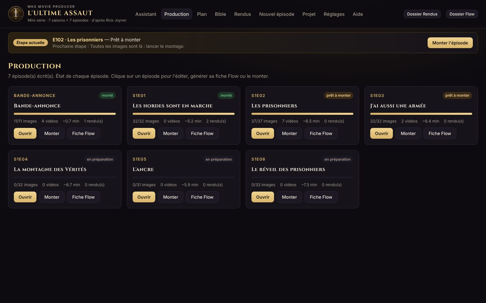

Une carte par épisode écrit, avec :

- l'état : *en préparation*, *prêt à monter* ou *monté* ;
- la jauge des images (par exemple 32/32 images), le nombre de vidéos, la durée estimée d'après la narration, le nombre de rendus ;
- les boutons **Ouvrir** (éditeur), **Monter** et **Fiche Flow**.

## 6. Éditeur d'épisode

**Ouvrir** une carte affiche l'épisode dans l'une des deux vues, au choix, grâce au sélecteur **☰ Liste / 🎬 Studio** placé en tête de la barre d'outils :

- **Liste** : tous les plans les uns sous les autres, avec tous leurs champs (la vue décrite ci-dessous) ;
- **Studio** : une interface de montage, avec moniteur d'aperçu, timeline et bibliothèque de médias (voir *Vue Studio* plus bas).

Le choix est mémorisé : le prochain épisode ouvert s'affiche dans la même vue. On peut basculer à tout moment, même avec des modifications non enregistrées : elles sont conservées.

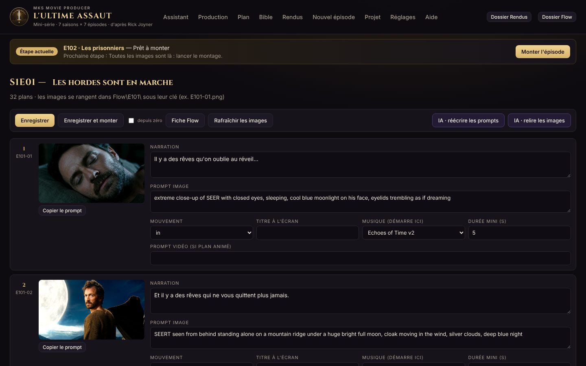

### La barre d'outils

| Bouton | Effet |
|---|---|
| **☰ Liste / 🎬 Studio** | Choisit la vue de l'épisode |
| **Enregistrer** | Enregistre le script. Il s'encadre d'or quand il y a des modifications non enregistrées. |
| **Enregistrer et monter** | Enregistre puis lance le montage |
| **depuis zéro** | À cocher avant de monter pour tout recalculer (voix comprises) |
| **Fiche Flow** | Génère et affiche la fiche de prompts (section 7) |
| **Rafraîchir les images** | Recharge les vignettes après avoir rangé de nouvelles images |
| **IA · réécrire les prompts** | L'IA réécrit les prompts d'image dans la direction artistique de la série ; une consigne est demandée (facultative) |
| **IA · relire les images** | L'IA regarde les images rangées et signale celles qui ne correspondent pas au prompt |

À chaque enregistrement, la version précédente est conservée dans le sous-dossier `anciennes` du dossier des épisodes (`E104_1.json`, `E104_2.json`…).

### Les champs d'un plan

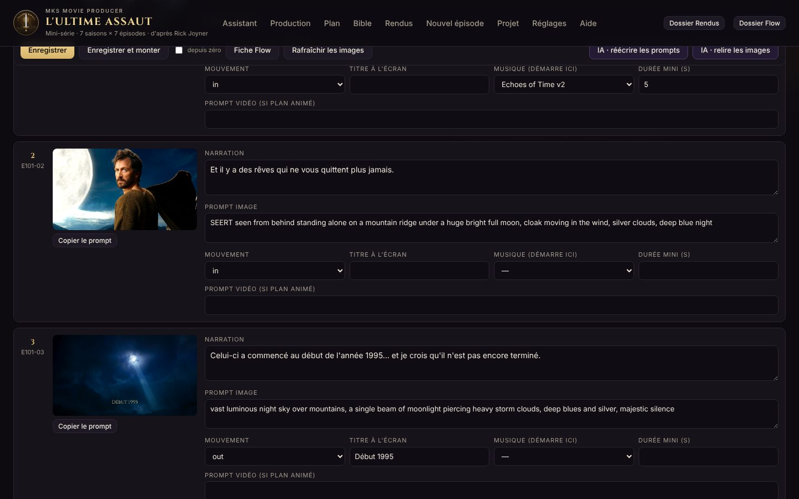

| Champ | Rôle |
|---|---|
| Numéro et clé | La clé (ex. `E101-02`) est le **nom de fichier** de l'image ou de la vidéo du plan |
| Vignette | L'image ou la vidéo du plan trouvée dans le projet ; survolez une vidéo pour la lire |
| **Copier le prompt** | Copie le prompt complet (style de la série + description des personnages) |
| **Narration / Réplique de** | Le menu choisit **qui parle** : *Narrateur* (voix off) ou un personnage du projet. Une réplique contient seulement les mots prononcés, sans guillemets ni « dit-il », et elle est lue avec la voix de ce personnage. La longueur du texte fixe la durée du plan. |
| **Prompt image** | Description de l'image, en anglais. Un tag de personnage comme `[VOYANT]` est remplacé par sa description. |
| **Mouvement** | Mouvement de caméra sur une image fixe (voir tableau) |
| **Titre à l'écran** | Mot-clé affiché en bas de l'image (ex. ORGUEIL) |
| **Musique (démarre ici)** | Change de piste à partir de ce plan, avec un fondu enchaîné de 3 secondes |
| **Durée mini (s)** | Durée minimale du plan, même si la narration est courte |
| **Ambiance (démarre ici)** | Fond sonore qui commence à ce plan et continue jusqu'au prochain changement : horde qui avance, armée en marche, louange, bataille, vent… *Couper l'ambiance* ramène le silence. Le menu rappelle l'ambiance en cours. ▶ pour l'écouter (section 21) |
| **Bruitage (début du plan)** | Son ponctuel joué au début du plan : cor, rugissement, tonnerre, épée, volée de flèches… ▶ pour l'écouter |
| **Niveau ambiance** | Volume de l'ambiance qui démarre à ce plan (1 = normal, 1,5 = plus fort, 0,5 = plus discret) |
| **Son de la vidéo · garder** | Garde le son de la vidéo du plan (par exemple une horde générée **avec** son par Flow) ; il s'ajoute à l'ambiance |
| **Prompt vidéo** | Description du mouvement si le plan doit être animé (section 7.3) |

| Mouvement | Effet |
|---|---|
| `in` | Zoom avant lent (par défaut) |
| `out` | Zoom arrière |
| `left` / `right` | Travelling vers la gauche / la droite |
| `up` / `down` | Panoramique vers le haut / le bas |
| `still` | Image presque fixe |

### Les cartons

Les lignes en pointillés (◆) sont des **cartons** : un écran titre avec un **Carton** (texte principal), un **Sous-titre** et une **Durée**. Chaque épisode en a deux, le titre après l'ouverture et « À SUIVRE » à la fin.

### Musiques disponibles

Clash Defiant, Crusade - Heavy Industry, Dark Walk, Darkest Child, Echoes of Time v2, Ever Mindful, Heroic Age, Interloper, Lightless Dawn, Long Note Four, Lord of the Land, Ossuary 6 - Air, Prelude and Action, Rising Game. Si aucun plan ne précise de musique, la piste par défaut du projet est utilisée sur tout l'épisode. Des musiques propres au projet peuvent être ajoutées depuis la vue Studio (onglet **Musiques** de la bibliothèque).

### Vue Studio : monter l'épisode comme dans un logiciel de montage

La vue **🎬 Studio** présente le même épisode à la manière d'un logiciel de montage (CapCut, Premiere…). Tout ce qui y est modifié est enregistré dans le même fichier que la vue Liste, avec le même bouton **Enregistrer** (ou **Ctrl+S**).

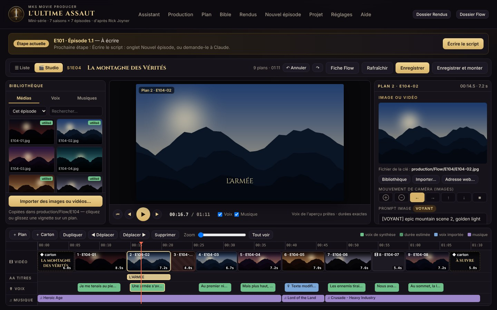

L'écran se compose de cinq zones :

| Zone | Rôle |
|---|---|
| **Barre du haut** | Titre de l'épisode (modifiable), durée totale, **↶ Annuler / ↷ Rétablir**, Fiche Flow, Rafraîchir, Enregistrer, Enregistrer et monter |
| **Bibliothèque** (à gauche) | Onglets **Médias**, **Voix** et **Musiques** : tout ce qui peut être placé dans un plan, avec recherche et filtre *Cet épisode / Personnages / Tout le projet* |
| **Moniteur** (au centre) | Aperçu de l'épisode : image ou vidéo du plan, mouvement de caméra, titre à l'écran, cartons, voix et musique. Boutons de lecture, position, cases **Voix** et **Musique** pour couper l'une ou l'autre |
| **Inspecteur** (à droite) | Tous les réglages du plan sélectionné : image ou vidéo, mouvement, prompts, narration, titre, durée mini, voix, musique |
| **Timeline** (en bas) | Les plans bout à bout à l'échelle du temps, sur quatre pistes : **Vidéo**, **Titres**, **Voix**, **Musique** |

**L'aperçu.** Il reproduit le montage : même durée de plan (narration + 1,5 s, au moins la durée mini), mêmes mouvements de caméra, même apparition des titres, mêmes fondus, musique qui baisse sous la voix. Les voix de l'aperçu sont générées en arrière-plan à l'ouverture (connexion internet nécessaire, comme pour le montage) ; tant qu'elles ne sont pas prêtes, les durées sont **estimées** (blocs hachurés sur la piste Voix) et deviennent exactes ensuite. L'aperçu est une maquette rapide : le rendu final reste celui du montage (**Enregistrer et monter**).

**La timeline.** Cliquer un plan le sélectionne et place la tête de lecture à son début ; cliquer ou glisser sur la règle déplace la tête de lecture. Le curseur **Zoom** élargit la timeline, **Tout voir** la remet à la largeur de l'écran. Les boutons au-dessus permettent d'ajouter un **plan** ou un **carton** après le plan sélectionné, de **dupliquer**, de **déplacer** ou de **supprimer** un plan. On peut aussi **glisser un plan** sur un autre pour changer l'ordre. Un plan sans image apparaît hachuré de rouge.

**Changer les éléments d'un plan.** Sélectionnez le plan, puis :

| Élément | Depuis la bibliothèque du projet | Depuis l'ordinateur ou ailleurs |
|---|---|---|
| **Image ou vidéo** | Cliquer une vignette de l'onglet **Médias**, ou la glisser sur le plan dans la timeline. Les vignettes marquées *utilisé* sont déjà dans l'épisode. | **Importer…** (inspecteur ou bas de la bibliothèque) : le fichier est copié dans le dossier des images de l'épisode. **Adresse web…** : une image ou une vidéo en ligne, téléchargée au montage. |
| **Voix** | Onglet **Voix** : **Voix du plan N**, ou glisser le fichier sur la piste Voix | **Importer…** un enregistrement (mp3, wav, m4a…), ou **● Enregistrer au micro** directement dans le navigateur |
| **Musique** | Onglet **Musiques** : **Démarrer au plan N**, glisser la piste sur la piste Musique, ou menu *Changer de musique à partir d'ici* dans l'inspecteur | **Importer une musique…** : elle rejoint les musiques du projet |
| **Texte** | Qui parle (narrateur ou personnage), narration ou réplique, titre à l'écran, prompts, durée mini : directement dans l'inspecteur. L'aperçu prend la voix du personnage choisi. | — |

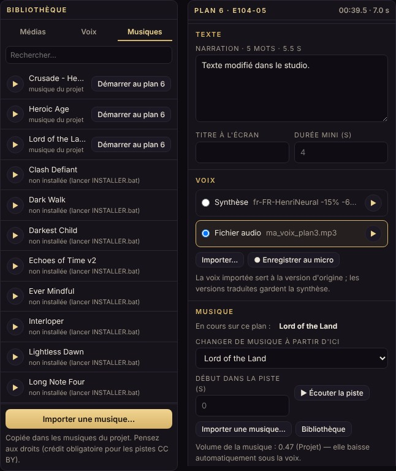

Quelques précisions :

- **Rien n'est écrasé** : un fichier importé qui porte le même nom qu'un fichier existant est renommé (`photo-2.jpg`). Les imports se rangent dans le dossier des images de l'épisode (`…\E104\`), les voix dans son sous-dossier `voix\`, les musiques dans le dossier des musiques du projet.
- **Retirer le choix** rend au plan son image d'origine, celle qui porte le nom de sa clé (`E104-03.png`). La Fiche Flow n'en demande plus la génération tant qu'une image est choisie dans le Studio.
- **Voix importée** : elle remplace la voix de synthèse pour la version d'origine uniquement ; les versions traduites gardent leur voix de synthèse. Cochez **Synthèse** pour revenir à la voix du projet.
- **Musique** : le réglage *Début dans la piste* fait démarrer la musique plus loin que son début (ex. 30 s pour sauter une introduction). Le volume général reste celui de **Projet › Vol. musique**.
- Les **versions linguistiques** (textes traduits côte à côte) se relisent dans la vue **Liste**.

| Raccourci (hors saisie de texte) | Effet |
|---|---|
| **Espace** | Lecture / pause |
| **← / →** | Plan précédent / suivant |
| **Début** | Retour au début de l'épisode |
| **Suppr** | Supprimer le plan sélectionné |
| **Ctrl+Z / Ctrl+Y** | Annuler / rétablir |
| **Ctrl+S** | Enregistrer |

## 7. Fiche de prompts et génération des images

### 7.1 La fiche

**Fiche Flow** génère le fichier `E104_fiche_Flow.txt` dans le dossier des fiches et l'affiche. Les plans où un personnage parle y sont marqués **RÉPLIQUE** ; leur prompt vidéo demande un personnage qui parle (mouvement des lèvres), avec le texte de la réplique et sa durée approximative. **Coupez le son généré par Flow** sur ces vidéos : la voix du personnage est ajoutée au montage.

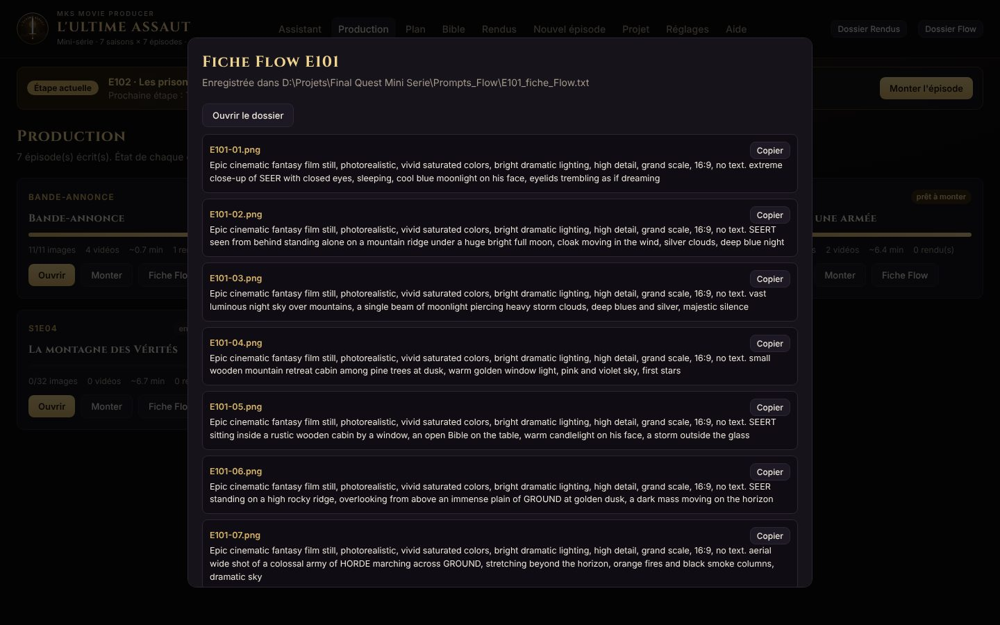

Chaque bloc donne le **nom du fichier à créer** (`E101-01.png`), le début de la narration et le **prompt complet** prêt à coller, avec un bouton **Copier**. Un plan dont l'image ou la vidéo existe déjà (dans le projet ou à une adresse web) est signalé « rien à générer » ; un plan repris d'un autre épisode (par exemple dans la bande-annonce) se génère avec la fiche de cet épisode. Les plans vidéo sont listés à la fin. **Ouvrir le dossier** affiche les fiches dans l'Explorateur.

### 7.2 Générer et ranger les images

1. Ouvrez votre générateur d'images (Google Flow, Higgsfield…), au format **16:9**.
2. Pour les plans où un personnage récurrent apparaît (la fiche l'indique entre crochets), ajoutez son **image de référence** (son emplacement est rappelé en tête de la fiche) comme ingrédient ou référence, pour garder le même visage d'un épisode à l'autre.
3. Collez le prompt, générez, choisissez la meilleure image.
4. Enregistrez-la **sous le nom exact indiqué** dans le dossier que la fiche indique en tête (par exemple `production\Flow\E104\`) : `E104-01.png`, `E104-02.png`… Les formats `.png`, `.jpg` et `.webp` sont acceptés. Une image rangée ailleurs dans le projet est quand même retrouvée par son nom.
5. Dans l'éditeur, **Rafraîchir les images** : les vignettes apparaissent et la jauge avance.

> Le nom du fichier fait tout : une image mal nommée n'est pas trouvée. En cas de doute, **Monter** ou l'Assistant indiquent les plans encore manquants.

### 7.3 Les plans animés

Pour 4 à 7 plans par épisode, la fiche propose un **prompt vidéo** : dans Flow, utilisez « Frames to Video » avec l'image du plan comme image de départ, 5 à 8 secondes, sans son. Exception : les plans marqués **GARDER LE SON** dans la fiche (case *Son de la vidéo* cochée), dont le prompt décrit le son attendu ; on garde alors le son généré, qui sert d'ambiance. Enregistrez la vidéo sous le **même nom en `.mp4`** (`E104-07.mp4`) dans le même dossier. **La vidéo est prioritaire sur l'image** au montage ; elle est ralentie si elle est plus courte que la narration.

### 7.4 Exporter les lots (générer par personnage)

Plutôt que de suivre la fiche plan par plan, on peut la découper en **lots** : un lot regroupe tous les prompts qui demandent **la même image de référence**. On charge cette référence une seule fois dans Flow, puis on lance tous les prompts du lot à la suite (à la main, ou avec une extension de génération par lot).

Cliquez sur **Exporter les lots** : sur la carte de l'épisode (Production), dans la barre d'outils de l'épisode (vues Liste et Studio) ou dans la fenêtre de la Fiche Flow. La fiche est régénérée, puis découpée ; une fenêtre récapitule les lots et **Ouvrir le dossier des lots** affiche les fichiers.

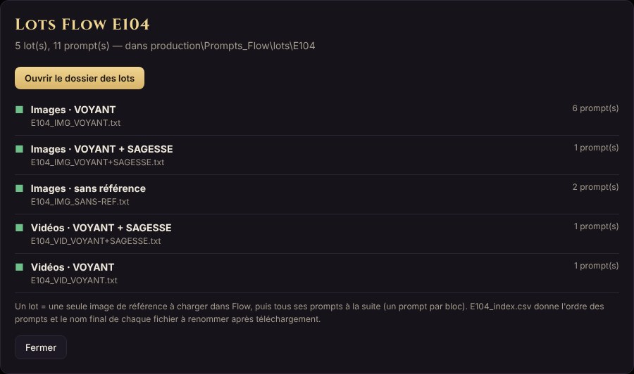

Les fichiers sont rangés dans le dossier des fiches, sous `lots\E104\` :

| Fichier | Contenu |
|---|---|
| `E104_IMG_VOYANT.txt` | Les prompts d'images où apparaît le Voyant : charger `Voyant_reference.png`, puis lancer les prompts dans l'ordre |
| `E104_IMG_VOYANT+SAGESSE.txt` | Les images avec plusieurs personnages : charger **toutes** les références nommées |
| `E104_IMG_SANS-REF.txt` | Les images sans personnage récurrent : aucune référence à charger |
| `E104_VID_….txt` | Les prompts vidéo, regroupés selon les personnages de leur image de départ |
| `E104_index.csv` | Pour chaque prompt : son lot, son rang dans le lot et le **nom final du fichier** (`E104-07.png`, `E104-07.mp4`…) |

Dans un fichier de lot, chaque prompt occupe un bloc, séparé du suivant par une ligne vide. Flow nomme les fichiers téléchargés à sa façon : renommez chacun d'après l'**index** (ouvrable dans Excel) avant de le ranger dans le dossier des images. Les plans dont l'image a été choisie dans le Studio ne figurent ni dans la fiche ni dans les lots.

## 8. Monter un épisode

Cliquez sur **Monter** (Production, éditeur ou Assistant). Le montage :

1. lit chaque narration avec la voix du projet ;
2. anime chaque image selon son mouvement, ajoute le titre à l'écran et les fondus ;
3. insère les cartons ;
4. place la musique par sections, la baisse automatiquement sous la voix et termine par un fondu ;
5. ajoute les ambiances et les bruitages (section 21), sous la musique, eux aussi baissés quand quelqu'un parle ;
6. exporte en **1920 × 1080, 25 images/s** dans le dossier des rendus, avec un fichier de sous-titres `.srt` du même nom (section 20.5).

Le premier montage d'un épisode de 7 minutes prend plusieurs minutes, selon la puissance du poste. Le journal s'affiche dans le panneau des tâches.

- **Un rendu ne remplace jamais le précédent** : le nouveau fichier reçoit `_v2`, `_v3`…
- **Remonter est rapide** : seuls les plans modifiés depuis le dernier montage (narration, image, mouvement, titre) sont recalculés. Cochez **depuis zéro** pour tout recalculer, par exemple après avoir changé la voix du projet.
- **Une image manquante n'arrête pas le montage** : le plan est remplacé par un écran noir « [plan manquant : E104-12] », et la liste des plans manquants s'affiche à la fin.
- La voix off utilise le service en ligne de Microsoft : le montage demande une connexion Internet.

## 9. Rendus et validation

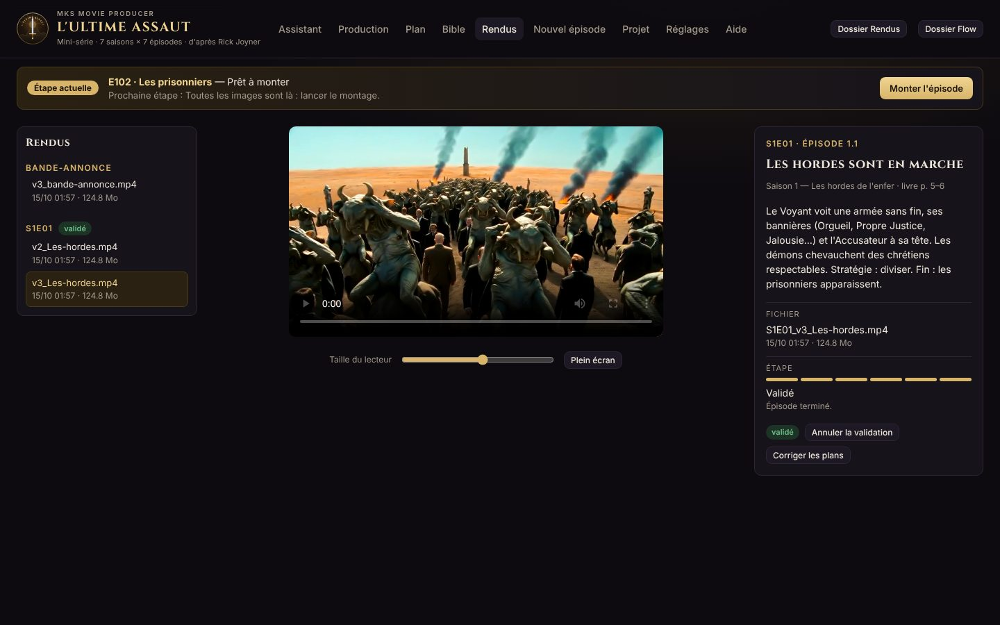

- **À gauche**, les rendus groupés par épisode, avec la date et la taille. Le badge *validé* signale les épisodes terminés.
- **Au centre**, le lecteur. Le curseur **Taille du lecteur** ajuste sa largeur (le réglage est mémorisé) ; **Plein écran** pour visionner.
- **À droite**, la fiche de l'épisode : titre, saison, pages du livre, résumé de la bible, fichier, étape.

Après visionnage :

- si l'épisode convient, **Valider E101** le marque terminé et l'Assistant passe à l'épisode suivant ;
- sinon, **Corriger les plans** ouvre l'éditeur ; corrigez, rangez les nouvelles images, puis remontez.

**Annuler la validation** remet l'épisode à l'étape « Monté ».

Les versions traduites apparaissent sous leur épisode avec un badge de langue, et le bouton **Sous-titres .srt** télécharge les sous-titres de la vidéo affichée (section 20). La validation porte sur l'épisode d'origine.

## 10. Plan

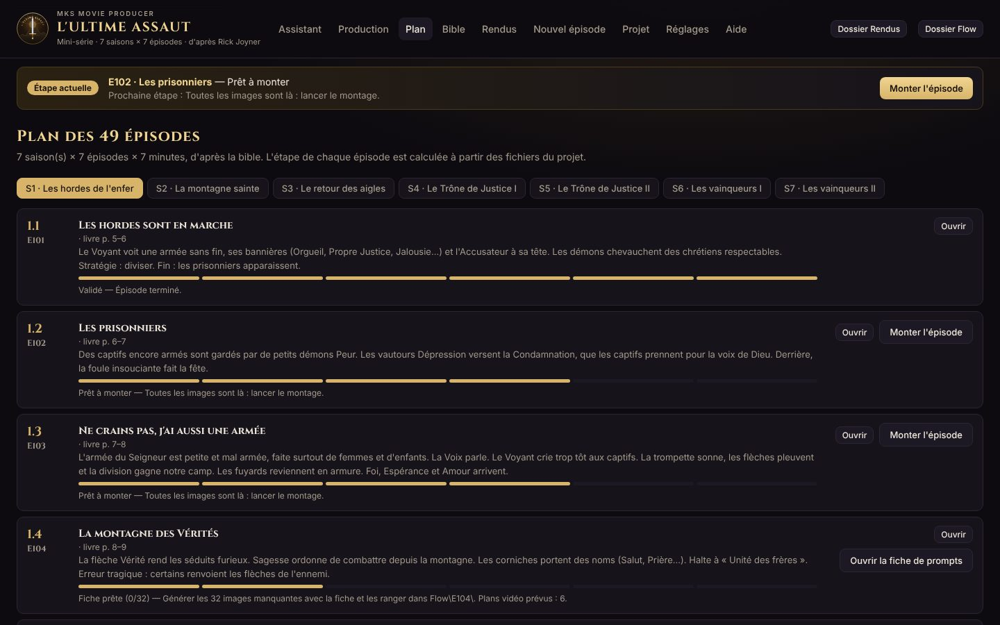

Le plan liste tous les épisodes prévus, saison par saison (onglets **S1**, **S2**…). Pour chacun : numéro, code, titre, pages du livre, résumé, barre d'étape, et l'action suivante. **Ouvrir** donne accès à l'éditeur dès que le script existe.

Le plan vient du fichier `plan.json` du dossier de la bible, écrit avec la bible (section 11) ou par l'IA.

## 11. Bible

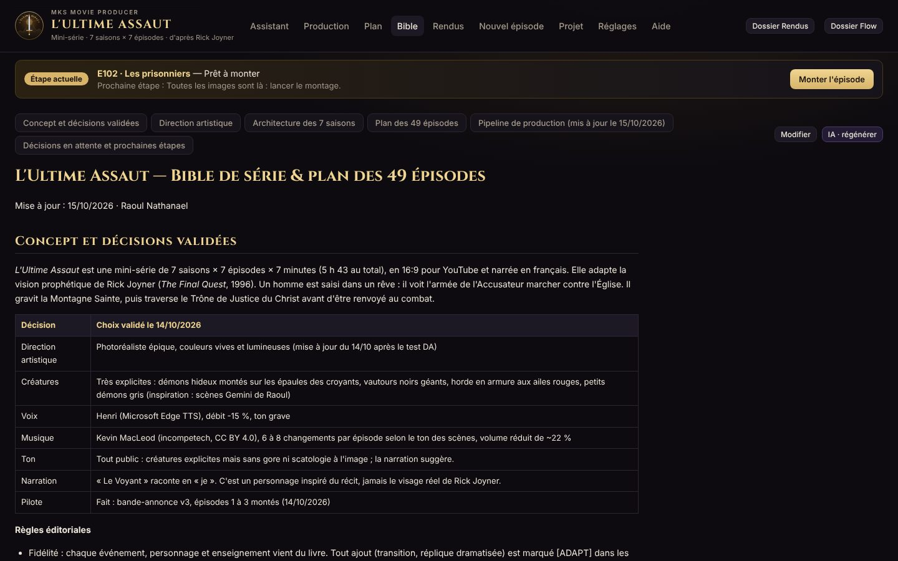

La bible rassemble les décisions de la série : concept, direction artistique, personnages, architecture des saisons, plan des épisodes, règles éditoriales. Les onglets en haut mènent directement à chaque section.

- **Modifier** ouvre l'édition en texte (format Markdown : `#` titre, `##` section, `- ` liste, `**gras**`, tableaux avec `|`).
- **IA · régénérer** fait réécrire la bible **et** le plan par l'IA à partir des sources du projet, avec vos consignes. L'ancienne version est conservée (`.ancien`).

L'IA relit la bible avant d'écrire chaque épisode : plus elle est précise, plus les épisodes sont cohérents.

## 12. Nouvel épisode (IA)

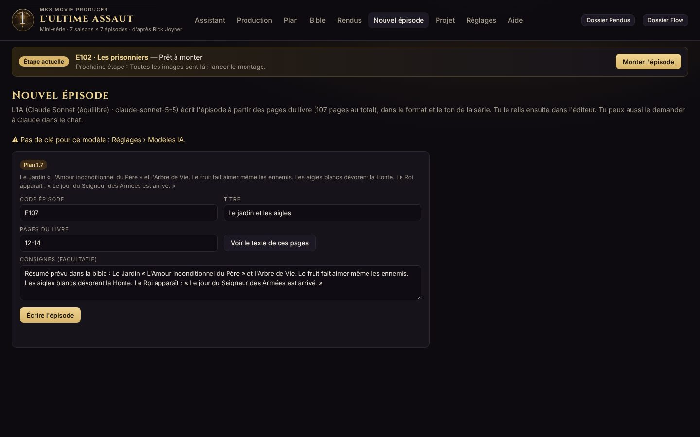

1. La page propose automatiquement le **prochain épisode à écrire** d'après le plan : code, titre, pages du livre, résumé prévu.
2. **Voir le texte de ces pages** affiche l'extrait du livre pour vérifier le découpage.
3. Ajoutez des **consignes** si besoin (ton, scène à développer, durée…).
4. **Écrire l'épisode** : l'IA rédige les plans dans le format de la série (narration, prompts, mouvements, musiques, cartons) en général en une à deux minutes. La fiche de prompts est générée dans la foulée.
5. Relisez et ajustez le résultat dans l'éditeur.

Le modèle utilisé est celui choisi dans **Réglages** pour « Écrire un épisode ». Un avertissement s'affiche si sa clé n'est pas enregistrée.

## 13. Projet

L'onglet Projet réunit tout ce qui définit l'œuvre ouverte.

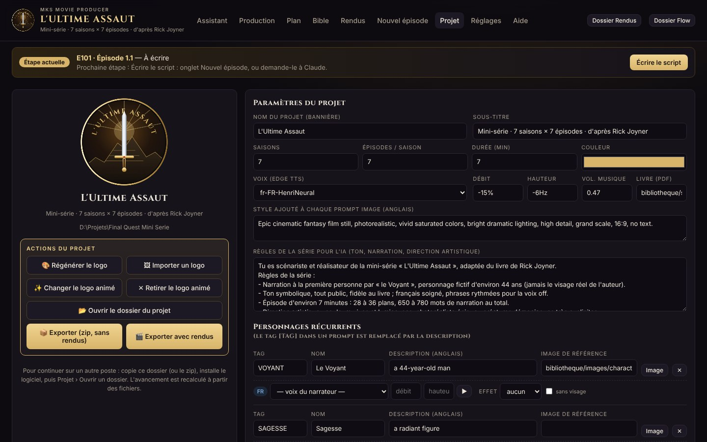

### 13.1 Identité, logo et actions du projet

Sous le logo, le cadre doré **Actions du projet** regroupe les boutons qui agissent sur le projet entier :

- **Régénérer le logo** dessine un emblème à partir du nom du projet et de sa couleur.
- **Importer un logo** remplace le logo par votre propre image (PNG, JPG, SVG).
- **Importer un logo animé** ajoute une version animée du logo (ex. un « sting » réalisé dans Claude Design). Il se joue une fois à l'ouverture de l'application, dans la bannière, puis reste sur sa dernière image ; le **survol** du logo le rejoue. Sur la page Projet, il se rejoue à chaque visite. Le logo fixe reste utilisé ailleurs (logo généré, exports) et reprend sa place si le navigateur ne peut pas lire l'animation. **Retirer le logo animé** revient au logo fixe (le fichier n'est pas effacé).
- **Ouvrir le dossier du projet** affiche le dossier du projet dans l'Explorateur.
- **Exporter (zip, sans rendus)** et **Exporter avec rendus** (boutons dorés) : voir 13.4.

> **Format conseillé pour un logo animé : WebM à fond transparent** (codec VP9 avec couche alpha), carré, environ 600 × 600, quelques secondes, **terminé sur le logo complet** (pas sur un fondu au noir) puisque l'animation s'arrête sur sa dernière image. Un MP4 fonctionne aussi, mais son fond est opaque : un carré sombre apparaît autour du logo. GIF, WebP ou PNG animés et SVG animé sont acceptés. Le fichier est noté dans `projet.json > logo_anime` ; il peut être rangé n'importe où dans le projet.

### 13.2 Paramètres

| Paramètre | Effet |
|---|---|
| Nom du projet, sous-titre | Affichés dans la bannière et sur le carton titre |
| Saisons, épisodes par saison, durée | Structure de la série ; guident l'IA pour la bible et le plan |
| Couleur | Couleur d'accent de l'interface et des logos générés |
| Voix, débit, hauteur | Voix off (Microsoft Edge), par exemple `fr-FR-HenriNeural`, `-15%`, `-6Hz` |
| Volume musique | 0 à 1 ; 0,47 par défaut |
| Volume ambiances | Niveau général des ambiances et bruitages ; 0,8 par défaut (0 = aucun son d'ambiance) |
| Livre (PDF) | Chemin du livre source, relatif au projet |
| Style ajouté à chaque prompt | Phrase de style collée devant chaque prompt d'image (en anglais) |
| Règles de la série pour l'IA | Ton, narration, public, direction artistique : lues par l'IA à chaque écriture |

Cliquez sur **Enregistrer le projet** après modification.

### 13.3 Personnages récurrents

Chaque personnage a un **tag** (ex. `VOYANT`), un nom, une **description en anglais** et une **image de référence**. Dans un prompt, `[VOYANT]` est remplacé par la description, et la fiche rappelle d'ajouter l'image de référence. **Image** dépose la référence dans le dossier des personnages ; **+ Personnage** en ajoute un.

**Voix des personnages.** Sous chaque personnage, une ligne par langue du projet (`FR`, `EN`…) règle la voix qui lit ses répliques : voix Edge TTS, débit, hauteur, et **▶** pour l'écouter. Sans voix choisie dans une langue, ses répliques sont lues par le narrateur de cette langue.

| Réglage | Effet |
|---|---|
| **Effet** `echo` | Léger écho, par exemple pour une voix divine ou céleste |
| **Effet** `grave` | Voix plus basse et plus lourde (créatures, ennemi) |
| **Effet** `lointain` | Voix filtrée et un peu distante (voix entendue de loin, souvenir) |
| **sans visage** | Le personnage n'est jamais montré de face : ses répliques ne demandent pas de vidéo où il parle |

Pour une série conversationnelle, déclarez les personnages qui parlent avant d'écrire les épisodes : l'IA d'écriture utilise leurs tags pour faire parler chacun avec sa voix.

### 13.4 Sources, export et projets du poste

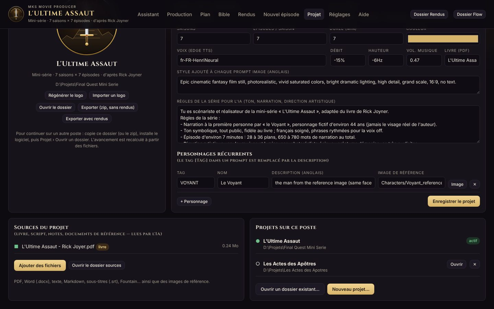

- **Sources du projet** : livre, scripts, notes, documents de référence. Formats lus par l'IA : PDF, Word (.docx), texte, Markdown, sous-titres (.srt), Fountain, CSV, JSON. **Ajouter des fichiers** les copie dans le dossier des sources.
- **Exporter (zip, sans rendus)** ou **Exporter avec rendus** (cadre *Actions du projet*, sous le logo) : crée un zip du projet dans le dossier des exports, pour l'archiver ou le transférer sur un autre poste.
- **Projets sur ce poste** : la liste des projets déjà ouverts ; **Ouvrir** bascule sur un autre projet, **✕** le retire de la liste (sans rien supprimer sur le disque).
- **Ouvrir un dossier existant…** ouvre un projet copié ou transféré. Si le dossier n'est pas encore un projet, l'application propose de l'initialiser.

### 13.5 Organisation du projet

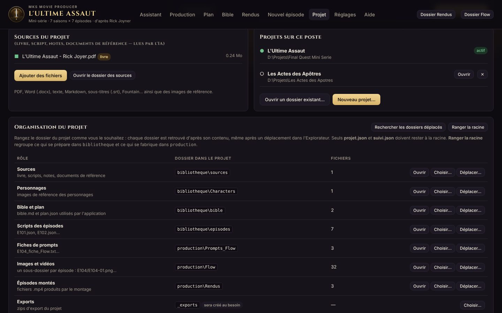

Ce tableau indique, pour chaque **rôle**, le dossier du projet que l'application utilise, et le nombre de fichiers qu'il contient.

- **Rangez librement** le dossier du projet dans l'Explorateur : renommez, regroupez, déplacez. Seuls `projet.json` et `suivi.json` doivent rester à la racine. Au lancement suivant, ou dès qu'un dossier manque, l'application le retrouve d'après son contenu et met le tableau à jour. Le livre, le logo et les images de référence sont retrouvés par leur nom de fichier.
- **Rechercher les dossiers déplacés** relance cette recherche tout de suite, sans redémarrer.
- **Ranger la racine** regroupe les dossiers restés à la racine : les sources, personnages, bible, épisodes et le logo dans `bibliotheque`, les fiches, images et rendus dans `production`, en gardant leur nom. La liste des déplacements est affichée avant confirmation, et les fiches de prompts sont réécrites avec les nouveaux chemins.
- **Choisir…** associe un rôle à un autre dossier existant du projet (si la recherche automatique s'est trompée, par exemple).
- **Déplacer…** déplace physiquement le dossier d'un rôle, avec son contenu, vers un nouvel emplacement du projet.
- **Ouvrir** affiche le dossier dans l'Explorateur.

> Après un rangement, les **fiches de prompts** déjà imprimées ou ouvertes indiquent l'ancien dossier des images. Régénérez-les (bouton **Fiche Flow**) pour avoir le bon chemin. Une image enregistrée par habitude dans l'ancien dossier est malgré tout retrouvée par son nom.

## 14. Créer un nouveau projet de A à Z

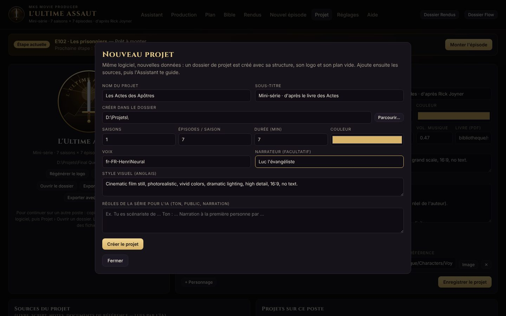

1. **Projet › Nouveau projet…** Indiquez le nom, le sous-titre, le dossier où le créer, le nombre de saisons, d'épisodes et leur durée, la couleur, la voix, le narrateur éventuel, le style visuel et les règles de la série. **Créer le projet**.
   Le dossier est créé avec sa structure (`bibliotheque` et `production`), son logo et un plan vide, et devient le projet actif.
   Variante : copiez le dossier `modele-projet` du logiciel, renommez-le, puis **Projet › Ouvrir un dossier existant…**
2. **Sources** : ajoutez le livre, le script de film ou de série, vos notes et documents de référence.
3. **Personnages** : décrivez le narrateur et les personnages récurrents ; générez puis déposez leur image de référence.
4. **Bible et plan** : suivez l'Assistant, **Générer la bible et le plan (IA)**, ou écrivez-les dans l'onglet Bible. Relisez et corrigez la bible : elle guide toute la suite.
5. **Pilote** : écrivez le premier épisode (section 12), générez ses images, montez-le. Ajustez la voix, le volume de la musique et le style jusqu'à obtenir le rendu voulu.
6. **Production** : suivez l'Assistant, épisode après épisode.

## 15. Réglages

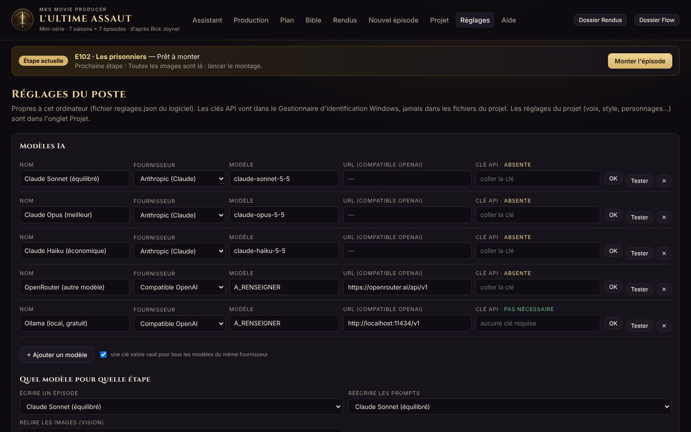

Les réglages sont propres à **ce poste** : les modèles d'IA disponibles, leurs clés et le modèle choisi pour chaque étape (écrire un épisode, réécrire les prompts, relire les images). La configuration pas à pas est décrite dans le Manuel d'installation (section 7). Les réglages de l'œuvre (voix, style, personnages) sont dans l'onglet **Projet**.

## 16. Travailler avec Claude

Tout ce que fait l'application peut aussi être demandé à Claude, à tout moment du processus :

- **Dans une conversation**, en lui donnant accès au dossier du projet : *« Écris l'épisode E107 d'après les pages 12 à 14 »*, *« Relis la bible et propose les titres de la saison 3 »*, *« Les images du plan E105-08 ne vont pas, propose un nouveau prompt »*.
- **Par MCP** (Claude Desktop ou Claude Code, voir le Manuel d'installation, section 8) : Claude lit l'état de la production, la bible et les sources, écrit les épisodes directement dans le projet, génère les fiches et lance les montages.
- **Par l'API**, depuis les boutons **IA** de l'application, avec le modèle de votre choix.
- **Pour les traductions**, Claude peut consulter leur état (`etat_traductions`) et écrire lui-même une version (`enregistrer_traductions`), ou faire appel à l'IA de l'application (`traduire_episode`).

Les fichiers écrits par Claude ou par l'IA sont les mêmes que ceux que vous éditez : vous pouvez reprendre la main dans l'éditeur à tout moment, et inversement.

## 17. Ligne de commande

Pour automatiser ou dépanner, `ATELIER.bat` ouvre un menu texte. Les mêmes commandes existent en ligne de commande, depuis le dossier du logiciel :

| Commande | Effet |
|---|---|
| `py -3 atelier.py monter E104` | Monte l'épisode (`--neuf` pour tout recalculer) |
| `py -3 atelier.py monter E104 --langue en` | Monte la version anglaise (section 20) |
| `py -3 atelier.py traduire E104 en "consignes"` | L'IA traduit les textes manquants ou à revoir (`--tout` pour tout refaire) |
| `py -3 atelier.py etat E104` | Liste les images manquantes |
| `py -3 atelier.py fiche E104` | Génère la fiche de prompts |
| `py -3 atelier.py lots E104` | Exporte la fiche par lots (un fichier par type et par personnage, plus l'index `.csv`) |
| `py -3 atelier.py ecrire E107 "Titre" 12-14 "consignes"` | L'IA écrit l'épisode |
| `py -3 atelier.py prompts E106` | L'IA réécrit les prompts |
| `py -3 atelier.py verifier E104` | L'IA relit les images |
| `py -3 atelier.py bible "consignes"` | L'IA écrit la bible et le plan |
| `py -3 atelier.py exporter --rendus` | Exporte le projet en zip |

Les commandes agissent sur le projet actif. Pour viser un autre projet, définissez d'abord la variable `STUDIO_PROJET` avec son chemin.

## 18. Bonnes pratiques

- **Tourner un pilote avant la série** : un épisode complet permet de régler la voix, la musique et le style une fois pour toutes.
- **Soigner la bible et les règles de la série** : c'est ce que l'IA relit à chaque épisode.
- **Garder les personnages constants** : toujours utiliser le tag et l'image de référence.
- **Nommer les images exactement** comme la fiche l'indique.
- **Créditer la musique** dans la description de chaque vidéo publiée : *Musique : Kevin MacLeod (incompetech.com), licence CC BY 4.0*.
- **Sauvegarder** : un export zip régulier du projet (sans rendus, il reste léger) suffit à tout reconstruire.

## 19. Questions fréquentes

**J'ai remplacé une image mais le film n'a pas changé.** Vérifiez que la nouvelle image porte exactement le même nom et se trouve dans le dossier des images de l'épisode (indiqué dans la fiche), puis remontez. Un fichier `.mp4` du même nom est prioritaire sur l'image.

Si une image a été **choisie dans la vue Studio** pour ce plan, c'est elle qui est utilisée : cliquez **Retirer le choix** dans l'inspecteur pour revenir au fichier nommé d'après la clé.

**Dans le Studio, la piste Voix est hachurée.** Les voix de l'aperçu ne sont pas encore prêtes (ou la connexion internet manque) : les durées affichées sont estimées d'après le nombre de mots. Le montage, lui, calcule toujours les durées exactes.

**L'Assistant reste sur un épisode que je veux sauter.** Il suit l'ordre du plan. Vous pouvez travailler sur n'importe quel épisode depuis Production ou Plan ; l'Assistant se mettra à jour.

**Puis-je travailler sur deux postes ?** Oui, mais pas en même temps sur le même dossier. Transférez le projet (export zip ou copie) ; l'avancement est recalculé à l'ouverture.

**Où sont mes vidéos finales ?** Dans le dossier des rendus du projet (bouton **Dossier Rendus** en haut à droite).

**J'ai réorganisé le dossier du projet : est-ce que ça casse quelque chose ?** Non, tant que `projet.json` et `suivi.json` restent à la racine. Les dossiers et fichiers déplacés sont retrouvés automatiquement ; vérifiez le résultat dans Projet › Organisation du projet.

**Le montage anglais refuse de démarrer.** L'épisode n'est pas entièrement traduit : la ligne de la langue, dans Production, indique combien de textes manquent. Lancez **Traduire**, ou complétez à la main dans l'éditeur.

**Faut-il regénérer les images pour une autre langue ?** Non. Les images sont communes ; seuls les textes et la voix changent.

**Comment revenir à une ancienne version d'un script ?** Les versions précédentes sont dans le sous-dossier `anciennes` du dossier des épisodes. Copiez celle voulue à la place de `E104.json` (les numéros vont de la plus ancienne à la plus récente).

## 20. Versions linguistiques et publication

Une série peut exister en plusieurs langues sans regénérer une seule image : les plans (clés, images, vidéos, mouvements, musiques) sont **communs** à toutes les langues ; seuls changent la narration, les mots à l'écran, les cartons, le titre de l'épisode et la voix. Chaque langue donne **sa propre vidéo**, avec ses sous-titres.

> Les images doivent rester **sans texte** (c'est le rôle de « no text » dans le style du projet) : c'est ce qui permet de les réutiliser dans toutes les langues. Tout texte visible est ajouté au montage, dans la bonne langue.

### 20.1 Déclarer une langue

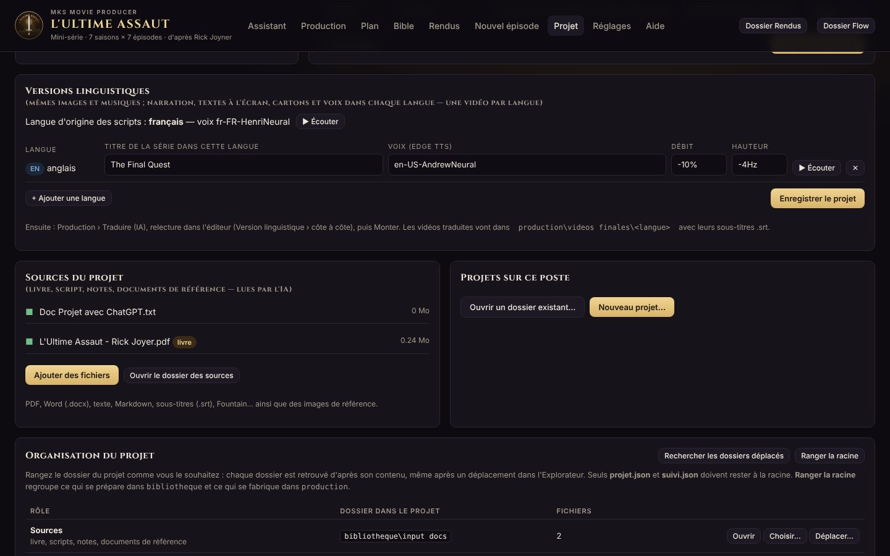

Dans **Projet › Versions linguistiques**, cliquez sur **+ Ajouter une langue** et saisissez son code (`en`, `es`, `de`, `pt`, `it`…). Pour chaque langue :

| Champ | Rôle |
|---|---|
| **Titre de la série** | Nom affiché sur le carton d'ouverture dans cette langue (ex. *The Final Quest*) |
| **Voix** | Voix Edge TTS de la langue ; la liste propose des voix masculines posées |
| **Débit / Hauteur** | Comme pour la voix d'origine (ex. `-10%`, `-4Hz`) |
| **▶ Écouter** | Fait lire une phrase d'essai avec ces réglages (connexion Internet nécessaire) |

Enregistrez le projet. Retirer une langue (✕) ne supprime ni les traductions déjà écrites ni les vidéos.

### 20.2 Traduire un épisode

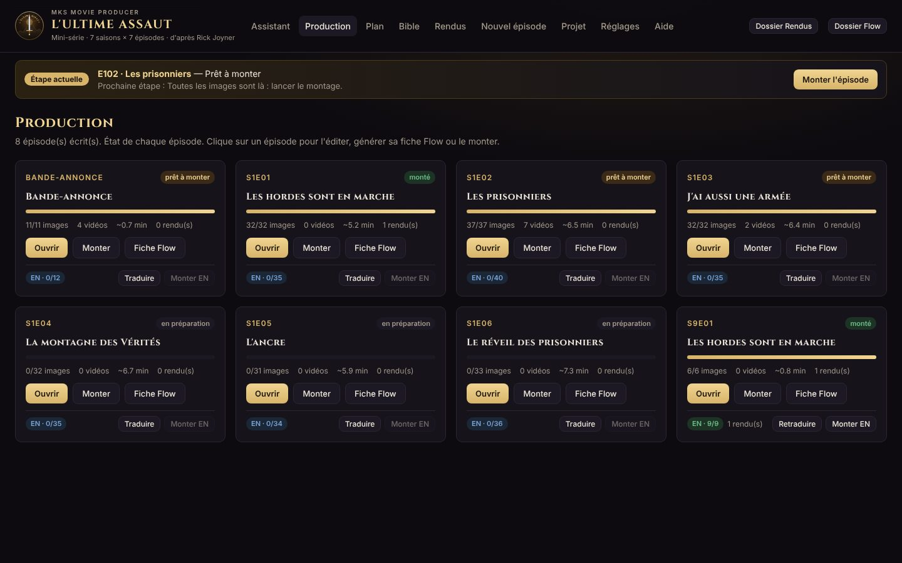

Dans **Production**, chaque épisode affiche une ligne par langue : `EN · 31/33` signifie que 31 textes sur 33 sont traduits (titre, narrations, mots à l'écran, cartons). **Traduire** confie la traduction au modèle choisi pour l'écriture dans Réglages.

- L'IA **adapte pour l'oral** : même ton, même personne de narration, longueur proche de l'original (chaque plan dure le temps de sa narration).
- La traduction est **incrémentale** : seuls les textes jamais traduits, ou dont le texte d'origine a changé depuis, sont envoyés au modèle. Retraduire un épisode à jour ne coûte rien.
- Si vous modifiez une narration d'origine après la traduction, le plan passe **à revoir** : la traduction existante reste utilisable, mais elle ne correspond plus au texte. Relancez **Traduire** pour ne refaire que ces plans-là.

### 20.3 Relire côte à côte

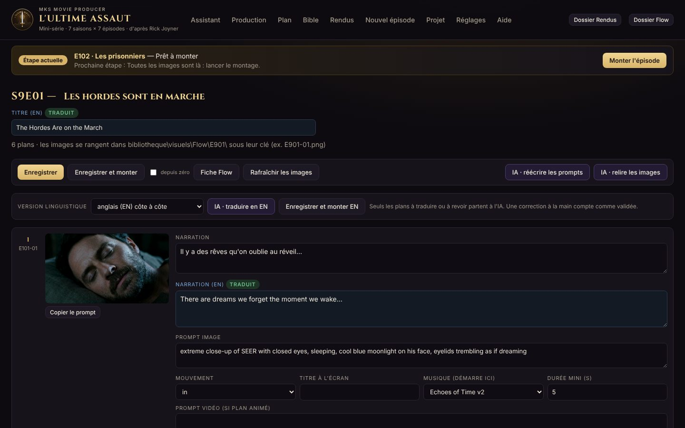

Dans l'éditeur, choisissez la langue dans **Version linguistique** : chaque plan affiche, sous la narration d'origine, sa traduction (en bleu) avec son état — *traduit*, *à traduire* ou *à revoir*. Corrigez directement ; une traduction corrigée à la main est considérée comme **validée** pour le texte d'origine actuel. Le choix de la langue est mémorisé.

Les boutons **IA · traduire en EN** et **Enregistrer et monter EN** agissent sur l'épisode ouvert.

### 20.4 Monter et retrouver la version traduite

**Monter EN** (Production ou éditeur) monte l'épisode avec la voix, les mots à l'écran et les cartons de la langue. Le montage **refuse un épisode incomplètement traduit** : on ne mélange jamais deux langues dans un film. Il prévient s'il reste des traductions *à revoir*.

- La vidéo va dans un sous-dossier du dossier des rendus : `rendus\en\S1E01_The-Hordes-Are-on-the-March_EN.mp4`.
- Les durées des plans suivent la narration de chaque langue : la version anglaise n'a pas exactement la durée de la version française.
- Le montage de chaque langue a son propre dossier de travail : remonter une langue ne recalcule pas l'autre.

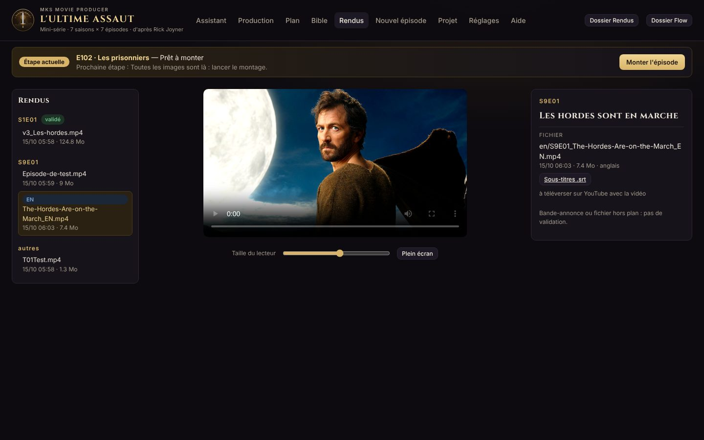

Dans **Rendus**, les versions traduites portent un badge de langue (`EN`) sous leur épisode.

### 20.5 Sous-titres

Chaque montage, dans chaque langue, écrit à côté de la vidéo un fichier de sous-titres **`.srt`** du même nom, calé sur la voix (phrases découpées en deux lignes de 42 caractères au plus). Le bouton **Sous-titres .srt** de la vue Rendus le télécharge.

### 20.6 Publier sur YouTube (une vidéo par langue)

Pour chaque langue, publiez la vidéo de cette langue comme une vidéo à part :

1. **Téléversez** le `.mp4` de la langue, puis, dans **Sous-titres**, ajoutez le `.srt` correspondant en indiquant la langue. YouTube peut ensuite proposer aux spectateurs une **traduction automatique** de ces sous-titres dans d'autres langues ; elle est bien meilleure à partir d'un `.srt` exact qu'à partir de sous-titres reconnus automatiquement.
2. **Titre et description dans la langue de la vidéo**, avec le crédit de la musique traduit, par exemple : *Music: Kevin MacLeod (incompetech.com), licensed under CC BY 4.0*.
3. **Reliez les versions** entre elles dans les descriptions (« Version française : lien »), et rangez chaque langue dans sa propre playlist.
4. **Doublage automatique de YouTube** : YouTube peut ajouter des pistes doublées par une voix de synthèse. Pour une vidéo qui existe déjà dans votre propre version, vérifiez ce réglage dans YouTube Studio (onglet Langues) et désactivez-le pour cette langue. Les fonctions et les langues proposées évoluent : référez-vous à YouTube Studio.

> **Droits** : pour une adaptation d'œuvre, l'autorisation de publier peut être accordée langue par langue. Vérifiez qu'elle couvre chaque version avant de la mettre en ligne.

## 21. Sons : ambiances et bruitages

Sous la voix et la musique, le montage ajoute une troisième couche : les **sons du monde** de la scène. Une horde qui avance ne s'entend pas comme une armée qui s'éveille ni comme une louange.

### 21.1 Ambiances et bruitages

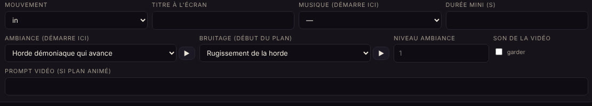

- Une **ambiance** couvre une scène : choisie sur un plan (*Ambiance (démarre ici)*), elle continue sur les plans suivants, avec un fondu enchaîné de 2 secondes, jusqu'au prochain changement ou jusqu'à *Couper l'ambiance*.
- Un **bruitage** est un son ponctuel joué au début d'un plan, décalé de 0,2 seconde (champ `sfx_t` du JSON pour un autre décalage). Un plan peut en avoir plusieurs (`"sfx": ["cor", "epee"]` dans le JSON).
- Les deux passent sous la musique et sont baissés automatiquement quand un personnage ou le narrateur parle.
- Dans la **vue Studio**, l'inspecteur du plan sélectionné a un bloc **Sons** avec les mêmes réglages.

| Ambiances | | Bruitages | |
|---|---|---|---|
| `horde` | Horde démoniaque qui avance | `cor` | Cor / shofar, appel de l'armée |
| `grondement` | Grondement lointain de l'ennemi | `rugissement` | Rugissement de la horde |
| `marche` | Armée du Seigneur en marche | `acclamation` | Acclamation de l'armée |
| `armee` | Camp de l'armée : murmures, armures | `epee` | Épée tirée qui résonne |
| `eveil` | Armée qui s'éveille, voix qui montent | `fleches` | Volée de flèches |
| `louange` | Louange : chœur lointain | `tonnerre`, `eclair` | Tonnerre, éclair |
| `bataille` | Bataille : cris, épées, impacts | `impact` | Impact sourd |
| `vautours` | Vautours : ailes, cris rauques | `souffle` | Passage d'un ange |
| `prisonniers` | Chaînes, gémissements | | |
| `brume` | Brume de condamnation, oppression | | |
| `feu` | Soufre et feu | | |
| `vent`, `hauteurs` | Vent sur la montagne ; air paisible des sommets | | |
| `sacre` | Présence sacrée, silence lumineux | | |

### 21.2 D'où viennent les sons

1. **Un fichier du projet**, s'il existe : `bibliotheque\sons\horde.mp3` (ou `.wav`, `.ogg`, `.flac`, `.m4a`). Il est prioritaire et joué en boucle sur toute la scène. Tout fichier du dossier est utilisable par son nom, même hors catalogue (par exemple `foule_jerusalem.mp3` → ambiance `foule_jerusalem`).
2. Sinon, une **synthèse de repli** fabriquée par l'application avec ffmpeg, sans téléchargement : disponible tout de suite, mais moins riche qu'un vrai enregistrement.

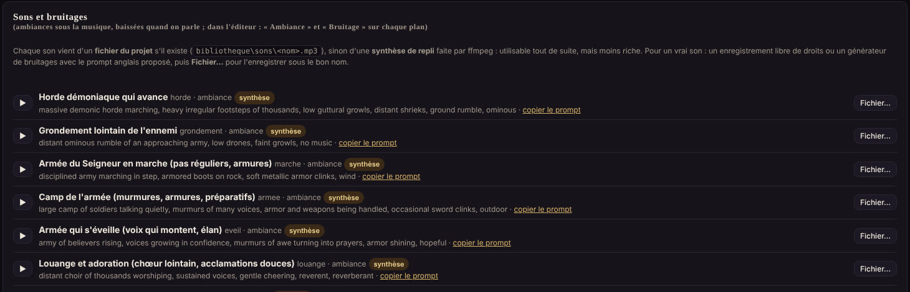

**Projet › Sons et bruitages** liste chaque son avec sa provenance (*fichier* ou *synthèse*), un bouton ▶ pour l'écouter, un **prompt anglais** à copier dans un générateur de bruitages et un bouton **Fichier…** qui enregistre un son sous le bon nom. La **fiche** de chaque épisode se termine par la liste des sons qu'il utilise, avec les mêmes prompts.

Pour un rendu réaliste, remplacez les synthèses par de vrais sons, en commençant par les plus présents (`horde`, `marche`, `armee`, `bataille`) :

- **enregistrements libres de droits** : banques de bruitages gratuites, en vérifiant la licence (domaine public, CC0, ou licence autorisant l'usage commercial sans crédit ; sinon, créditer dans la description de la vidéo comme la musique) ;
- **générateur de bruitages par IA** : collez le prompt anglais de la fiche ; une boucle de 30 secondes suffit pour une ambiance ;
- **le son de Flow** : pour un plan de foule animé, générez la vidéo avec son et cochez *Son de la vidéo · garder*.

Le dossier des sons est un rôle du projet comme les autres (section 13.5) : il peut être déplacé, il est retrouvé d'après son contenu.

### 21.3 Régler le volume

- **Projet › Paramètres › Volume ambiances** règle l'ensemble (0,8 par défaut).
- **Niveau ambiance** sur un plan règle une scène (1,5 pour une bataille au premier plan, 0,5 pour une horde lointaine).
- Remonter un épisode après un changement de son ne recalcule que les sons modifiés.

## 22. Glossaire

| Terme | Définition |
|---|---|
| Projet | Dossier contenant tout ce qui concerne une œuvre |
| Bible | Document de référence de la série (`bible.md`) |
| Plan | Liste des épisodes prévus (`plan.json`) |
| Plan (d'épisode) | Une image ou vidéo avec sa narration ; un épisode en compte environ 30 |
| Clé | Nom d'un plan, ex. `E104-07`, qui sert de nom de fichier |
| Carton | Écran titre entre les plans |
| Fiche de prompts | Liste des prompts d'un épisode, à copier dans le générateur d'images |
| Tag | Nom court d'un personnage entre crochets, ex. `[VOYANT]` |
| Rendu | Épisode monté, fichier `.mp4` du dossier des rendus |
| Rôle | Fonction d'un dossier du projet (sources, images, rendus…) ; voir Projet › Organisation du projet |
| MCP | Protocole qui permet à Claude d'utiliser directement l'application |
| Version linguistique | Langue supplémentaire de la série : mêmes plans, textes et voix traduits, vidéo séparée |
| À revoir | Traduction écrite pour un texte d'origine qui a changé depuis |
| SRT | Format de fichier de sous-titres accepté par YouTube et la plupart des lecteurs |
| Ambiance | Fond sonore d'une scène (horde, armée, louange…), du plan où il est choisi jusqu'au prochain changement |
| Bruitage | Son ponctuel au début d'un plan (cor, rugissement, tonnerre…) |
| Synthèse de repli | Son fabriqué par l'application quand le projet n'a pas de fichier pour ce son |
